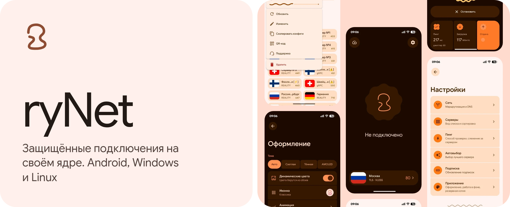
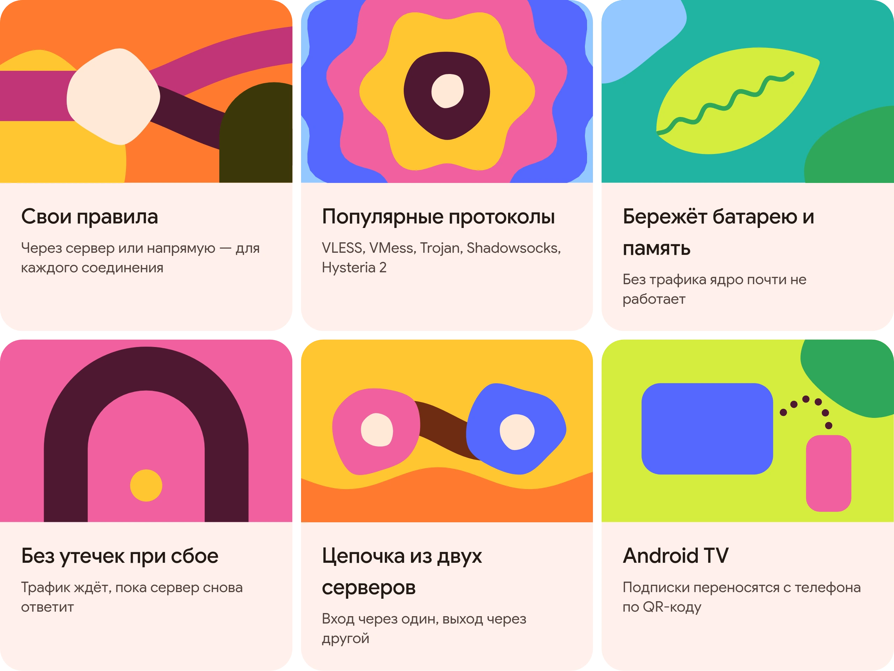

<picture>
  <source media="(prefers-color-scheme: dark)" srcset=".github/assets/banner-dark.webp">
  
</picture>

<p align="center">
  <a href="https://rynet.app/download/"><picture><source media="(prefers-color-scheme: dark)" srcset=".github/assets/btn-download-dark.webp"></picture></a>
  <a href="https://t.me/rynetforum"><picture><source media="(prefers-color-scheme: dark)" srcset=".github/assets/btn-forum-dark.webp"></picture></a>
  <a href="https://rynet.app/"><picture><source media="(prefers-color-scheme: dark)" srcset=".github/assets/btn-site-dark.webp"></picture></a>
</p>

<p align="center">Клиент для защищённых подключений со своим ядром на Rust:<br>Android, Android TV, Windows и Linux.</p>

<picture>
  <source media="(prefers-color-scheme: dark)" srcset=".github/assets/features-dark.webp">
  
</picture>

## Протоколы

VLESS (REALITY, TLS, XTLS Vision, XHTTP, gRPC, WebSocket, HTTPUpgrade, VLESS Encryption) ·
VMess AEAD · Trojan · Hysteria 2 · Shadowsocks (AEAD и 2022) · SOCKS · HTTP

ClientHello совпадает с uTLS: Chrome, Firefox, Safari, iOS, Edge.

Работает через TUN или как локальный SOCKS5/HTTP-прокси, для серверов есть `rynet-cli`.

## Сборка

| Папка | Что внутри |
|---|---|
| [`core`](core) | ядро на Rust |
| [`android`](android) | приложение для Android и Android TV (Kotlin, Jetpack Compose) |
| [`desktop-qt`](desktop-qt) | приложение для Linux и Windows (Qt Quick) |

Нужны Rust (stable; для Android ещё nightly с `rust-src`), JDK 21, Android SDK и NDK 29.0.14206865,
для ПК — Qt 6.8+ и CMake.

```bash
cd core && cargo test --workspace --locked
cd android && ./gradlew assembleRelease
cd core && cargo build --release -p rv-desktop
cd desktop-qt && cmake -S . -B build -G Ninja -DCMAKE_BUILD_TYPE=Release && ninja -C build
```

Пакеты для Linux и Windows собирают скрипты из [`desktop-qt/packaging`](desktop-qt/packaging).

## Лицензия

[GPL-3.0-or-later](LICENSE). Сторонние компоненты сохраняют свои лицензии: uTLS
([`core/rv-tls/src/hello/LICENSE-utls.txt`](core/rv-tls/src/hello/LICENSE-utls.txt)), патченные
крейты в [`core/vendor`](core/vendor), флаги [flag-icons](https://github.com/lipis/flag-icons) (MIT),
шрифт Google Sans Flex (OFL), Wintun.
