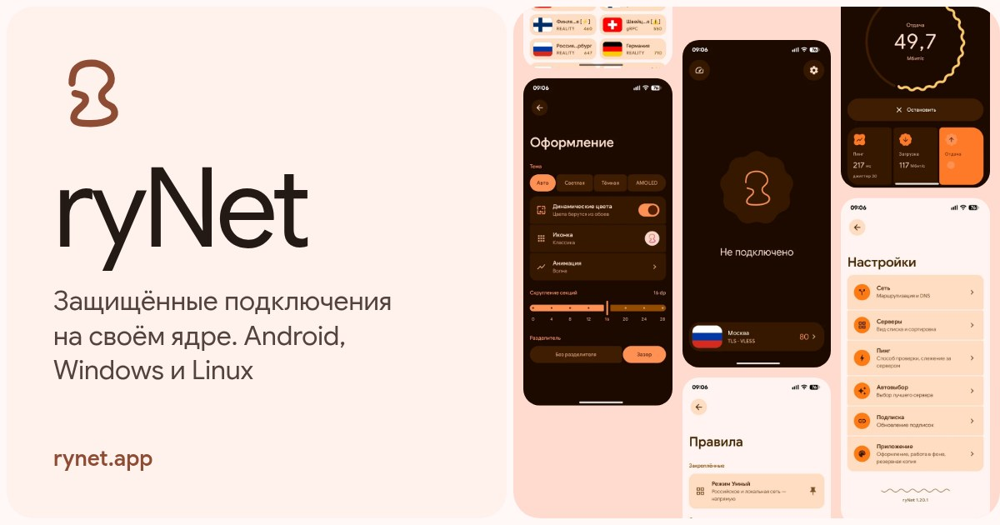

<p align="center">
  
</p>

<p align="center">
  <a href="https://rynet.app/download/"></a>
  <a href="https://t.me/rynetforum"></a>
  <a href="LICENSE"></a>
</p>

Клиент для защищённых подключений со своим ядром на Rust: Android, Android TV, Windows и Linux.

## Возможности

- Свой TCP-стек в userspace: без трафика ядро не просыпается.
- Маршрутизация по приложениям, доменам и IP.
- Автовыбор сервера и переход на резервный при сбое.
- Трафик блокируется, пока сервер не отвечает.
- Цепочка из двух серверов.
- TUN или локальный SOCKS5/HTTP-прокси.
- Android TV: подписки переносятся с телефона по QR-коду.
- `rynet-cli` для Linux и Windows.

## Протоколы

VLESS (REALITY, TLS, XTLS Vision, XHTTP, gRPC, WebSocket, HTTPUpgrade, VLESS Encryption) ·
VMess AEAD · Trojan · Hysteria 2 · Shadowsocks (AEAD и 2022) · SOCKS · HTTP

ClientHello совпадает с uTLS: Chrome, Firefox, Safari, iOS, Edge.

## Сборка

| Папка | Что внутри |
|---|---|
| [`core`](core) | ядро на Rust |
| [`android`](android) | приложение для Android и Android TV (Kotlin, Jetpack Compose) |
| [`desktop-qt`](desktop-qt) | приложение для Linux и Windows (Qt Quick) |

Нужны Rust (stable; для Android ещё nightly с `rust-src`), JDK 21, Android SDK и NDK 29.0.14206865,
для ПК — Qt 6.8+ и CMake.

```bash
cd core && cargo test --workspace --locked
cd android && ./gradlew assembleRelease
cd core && cargo build --release -p rv-desktop
cd desktop-qt && cmake -S . -B build -G Ninja -DCMAKE_BUILD_TYPE=Release && ninja -C build
```

Пакеты для Linux и Windows собирают скрипты из [`desktop-qt/packaging`](desktop-qt/packaging).

## Лицензия

[GPL-3.0-or-later](LICENSE). Сторонние компоненты сохраняют свои лицензии: uTLS
([`core/rv-tls/src/hello/LICENSE-utls.txt`](core/rv-tls/src/hello/LICENSE-utls.txt)), патченные
крейты в [`core/vendor`](core/vendor), флаги [flag-icons](https://github.com/lipis/flag-icons) (MIT),
шрифт Google Sans Flex (OFL), Wintun.
